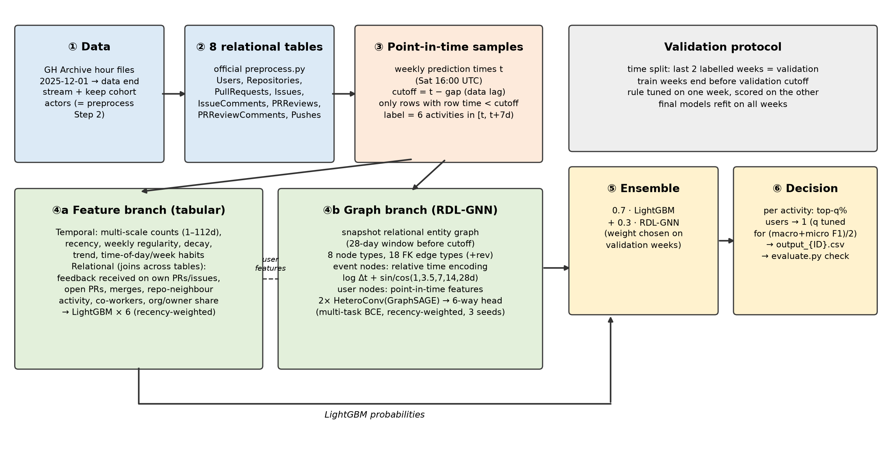

# Assignment 2 – Predicting GitHub User Activity

Predict, for every test user, whether they will `open_pr`, `open_issue`, `issue_comment`,
`pr_review`, `pr_review_comment` and `push` during the test week
**2026/11/22 00:00 – 11/29 00:00 (Taiwan time)**.

Method: **Relational Deep Learning (heterogeneous temporal GNN over the 8 tables) + a
point-in-time LightGBM feature model, ensembled (0.7 LightGBM + 0.3 GNN)**. Per activity,
the top-q% users are predicted 1, with q tuned for `Score = (macro-F1 + micro-F1) / 2`.
This rate rule is robust to the strong drift in GH Archive coverage, where probability
thresholds are not.

Validation (weeks of 10/31 and 11/07, 4,465 test users, rule tuned on the other week):

| Model | Score |
|---|---|
| Copy last week | 29.8 |
| LightGBM (temporal + relational features) | 37.4 |
| RDL-GNN + user features + time encoding | 39.2 |
| **Ensemble (submitted)** | **40.3** |



## Repository layout

```
assignment2/            official course repo (cloned, unchanged): preprocess.py, evaluate.py, test_input.csv
src/
  download_filter.py    stream GH Archive hour files, keep only cohort actors' lines
  common.py             paths, test-week time, table loading, activity log / labels, F1 metrics
  features.py           point-in-time user features (temporal + cross-table relational)
  gnn.py                snapshot relational entity graph builder + RelGNN model (PyG)
  prepare.py            stage 1 – features & labels for every weekly prediction time
  train_lgbm.py         stage 2 – LightGBM (variants: temporal / full)
  train_gnn.py          stage 3 – RDL-GNN (variants: full / none / --no_time)
  ensemble.py           stage 4 – baselines, ensemble, thresholds, results table, output csv
  draw_graphs.py        Q1 schema graph, Q1 relational entity graph, Q4 framework figure
  plots.py              analysis figures (regime shift, model comparison, feature importance)
figures/                all figures used in the slides
run_all.sh              runs everything end to end
```

## How to run

Requirements: Python 3.12, `pandas pyarrow numpy lightgbm scikit-learn matplotlib networkx
torch torch_geometric` (a CUDA GPU is optional; the GNN also runs on CPU, slower).

```bash
# 0. environment
uv venv --python 3.12 .venv
uv pip install --python .venv pandas pyarrow numpy lightgbm scikit-learn matplotlib networkx tqdm torch_geometric
uv pip install --python .venv torch --index-url https://download.pytorch.org/whl/cu124
git clone --depth 1 https://github.com/nycubigdata-2026fall/BigData2026-Assignment2.git assignment2

# 1. data: download GH Archive (2025-12-01 → latest hour) keeping only cohort users' events,
#    then build the 8 tables with the OFFICIAL preprocess.py
python src/download_filter.py --start 2025-12-01T00 --end 2026-11-18T09 --out raw_filtered
python assignment2/scripts/preprocess.py --raw raw_filtered --out data

# 2-5. features, models, ensemble, submission, figures
bash run_all.sh 315551143
```

`download_filter.py` applies exactly the same actor filter as Step 2 of `preprocess.py`
(`code_int("user", actor_id) in cohort`), so the tables are identical to running
`preprocess.py` on the full raw files, but only a few KB per hour are stored instead of
~15 MB.

The output file `output_<studentID>.csv` is written to the repo root and checked with the
official `assignment2/scripts/evaluate.py`.

## Leakage rules that the code follows

* Every feature for prediction time *t* uses only rows whose **row time** (`first_seen_at`
  or `created_at`, as in the official README) is before `cutoff = t − gap`.
* `gap` = test-week start − last timestamp in our data, so training samples see the same
  blind period as the real prediction.
* "Known-only-later" columns (`merged_at`, `merged_by_id`, `closed_at`, `state_reason`,
  `dismissed_at`) are used only when their value is `< cutoff`.
* Train / validation split by time: the last 2 labelled weeks are validation, and training
  label windows end before the validation cutoff.
